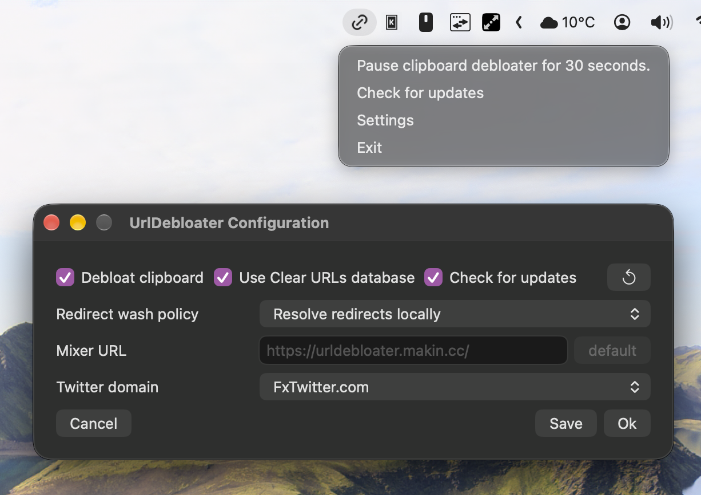
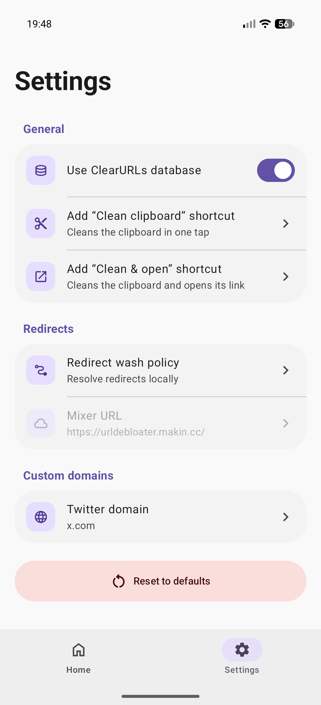

# UrlDebloater

Remove tracking params from URLs.

## Installation

### Android

### Other platforms
TODO

## Supported websites
- Youtube & Youtube music (clears url query params)
- Twitter (clears url query params)
- TikTok (unshorts vm.tiktok.com links)
- Soundcloud (unshorts on.soundcloud.com links)
- Spotify (clears url query params on open.spotify.com)
- all other sites from [ClearURLs rules](https://github.com/ClearURLs/Rules)

## Features
- automatically extract links from clipboard
- unshorten tiktok per user links (https://vm.tiktok.com/PerUserGeneratedPath) to "anonymous" links (https://tiktok.com/@user/video/852438128934291) \
  ⚠️ it sends request to tiktok in background to achieve this (can still be correlated with your IP address, see mixing capabilities) ⚠️
- tray icon with helpful shortcuts
- gui configuration (native widgets: GTK 4 on Linux, WinUI 3 on Windows, AppKit on macOS)

### Todo
- http/socks5 proxy support

### Unshortening
To unroll and debloat some URLs like vm.tiktok.com there is need to ask their servers for more information.
UrlDebloater by default sends request from your network to resolve it.\
There is possibility to use [mixer](mixer) (a web server exposing endpoint to unshort URL from network where mixer is hosted, it is AKA "proxy"). I host public instance of mixer at [https://urldebloater.makin.cc](https://urldebloater.makin.cc/). http/socks5 proxies are in todo list.

## Showcase

Configuration window and tray:\

https://github.com/makindotcc/UrlDebloater/assets/9150636/12d83dd8-9c60-4ada-94be-11afbf2ba260

### Android

Android settings:\

### iOS

### Todo

i need to think about it. \
Maybe add shortcut action, so it can be painlessly run from home screen like here:

https://github.com/makindotcc/UrlDebloater/assets/9150636/7e7de474-ffe9-49a2-ac8c-f75f6006fd34

# Credits

Tray and app icons provided by [tabler.io](https://tabler.io/icons).
